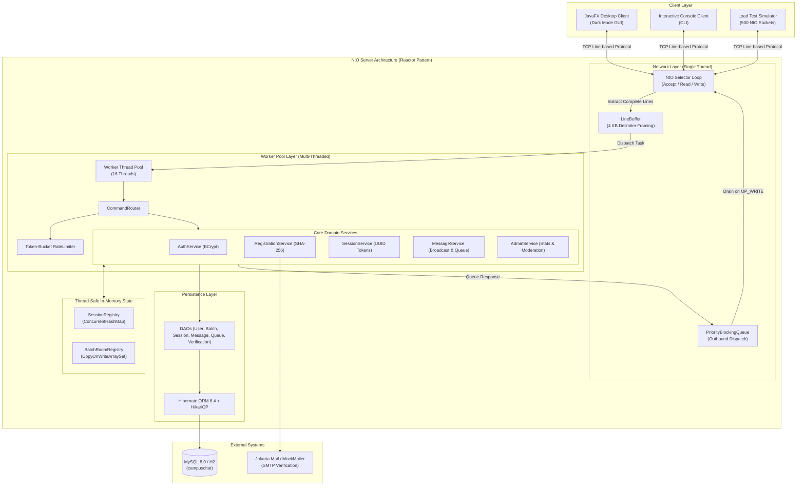
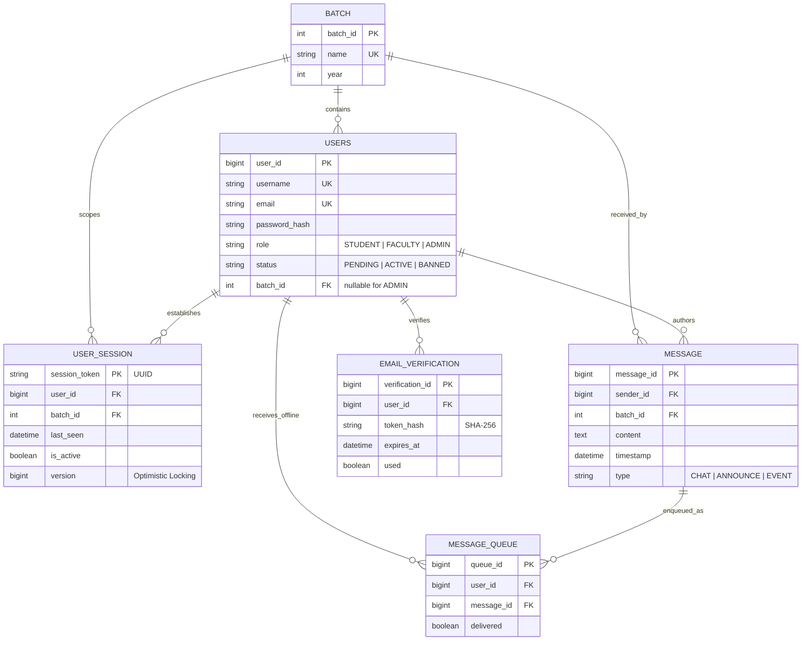

# Campus Chat System

[](https://openjdk.org/)
[](https://openjfx.io/)
[](https://hibernate.org/orm/)
[](https://www.mysql.com/)
[](https://github.com/brettwooldridge/HikariCP)
[](https://junit.org/junit5/)
[](#)

> **A high-concurrency, batch-scoped institutional messaging platform built with Core Java NIO, multi-threaded worker pools, Hibernate 6 ORM, and a modern JavaFX desktop client.**

---

## Table of Contents

- [Overview](#overview)
- [Key Features](#key-features)
- [System Architecture](#system-architecture)
  - [Architectural Diagram](#architectural-diagram)
  - [Threading Model](#threading-model)
  - [Layered Architecture](#layered-architecture)
- [Data Model & Database Schema](#data-model--database-schema)
  - [Entity Relationship Overview](#entity-relationship-overview)
  - [Entity Specifications](#entity-specifications)
  - [Indexing & Query Optimization](#indexing--query-optimization)
- [Network Protocol Specification](#network-protocol-specification)
  - [Wire Framing Rules](#wire-framing-rules)
  - [Client-to-Server Commands](#client-to-server-commands)
  - [Server-to-Client Responses](#server-to-client-responses)
- [Project Directory Structure](#project-directory-structure)
- [Technology Stack](#technology-stack)
- [Prerequisites & Setup](#prerequisites--setup)
  - [1. Prerequisites](#1-prerequisites)
  - [2. Database Configuration](#2-database-configuration)
  - [3. Verify Database Connectivity](#3-verify-database-connectivity)
- [Running the System](#running-the-system)
  - [Start the NIO Server](#start-the-nio-server)
  - [Start the JavaFX Desktop Client](#start-the-javafx-desktop-client)
  - [Start the Interactive Console Client](#start-the-interactive-console-client)
  - [Run the 500-Connection Load Test](#run-the-500-connection-load-test)
- [Automated Testing](#automated-testing)
- [End-to-End Demo Walkthrough](#end-to-end-demo-walkthrough)
- [Security & Reliability Safeguards](#security--reliability-safeguards)

---

## Overview

Traditional campus communication channels suffer from distinct failure modes:
- **ERP Portals**: Passive and pull-based; students rarely check them in time for emergency schedule changes.
- **Instant Messengers (e.g., WhatsApp)**: Decentralized, lacking institutional role enforcement; critical announcements get buried under social chatter.
- **Standard Sockets**: Fragile network state where messages dispatched to offline users fail silently and are permanently lost.

**Campus Chat System** is designed specifically to solve these challenges. Operating on a **Reactor pattern over non-blocking Java NIO**, it multiplexes hundreds of concurrent client connections over a single selector thread, deciphers commands into a dedicated thread pool, and provides **guaranteed delivery**:
- An offline user's incoming messages are queued in a relational persistence layer.
- Upon reconnecting with a secure session token, the server automatically synchronizes missed messages in strict chronological order.
- Faculty announcements preempt regular chat through client-level **priority queues**.
- Administrative telemetry displays real-time connection counters, active batches, and moderation controls.

---

## Key Features

- **Reactor Pattern Java NIO Server**: Non-blocking `Selector` multiplexing supporting 500+ simultaneous connections on a single I/O thread with sub-20ms average response latency.
- **Strict Non-Blocking Guarantees**: Database transactions (Hibernate 6) and email verification routines run strictly within a bounded worker thread pool, preventing selector stalls.
- **Guaranteed Offline Message Queuing**: Messages intended for offline batch members are persisted to `message_queue` and flushed upon reconnection between `SYNC_START` and `SYNC_END`.
- **Token-Based Session Recovery**: Clients re-establish lost connections without re-submitting passwords; optimistic locking with `@Version` eliminates duplicate reconnect races.
- **Priority-Ordered Outbound Dispatch**: Every connection maintains a `PriorityBlockingQueue` where `ANNOUNCE` ranks above `EVENT`, which ranks above `CHAT`.
- **Token-Bucket Rate Limiting**: Per-connection token buckets protect chat rooms from student flooding while exempting faculty members.
- **Institutional Email Verification**: Domain-restricted (`@vcet.edu.in`) registration with SHA-256 hashed one-time tokens expiring in 15 minutes and hourly resend throttling.
- **Role-Based Access Control (RBAC)**: Enforces three distinct privilege tiers on every inbound frame:
  - `STUDENT`: Scoped strictly to their registered batch.
  - `FACULTY`: Post high-priority announcements and event cards across batches.
  - `ADMIN`: Global oversight, batch provisioning, user status moderation (Active/Banned), and role assignment.
- **Live Admin Dashboard**: Real-time telemetry monitoring online users, active sessions, pending queue count, and daily message volumes.
- **Dual Client Implementations**:
  - **Modern JavaFX Desktop Client**: Sleek dark-mode GUI with pinned announcement ribbons, event cards, live sync indicators, and administrative dashboards.
  - **Interactive CLI Client**: Full-featured terminal interface for scripting and headless testing.

---

## System Architecture

### Architectural Diagram



### Threading Model

| Thread / Pool | Responsibility | Blocking Policy |
| :--- | :--- | :--- |
| **NIO Selector Thread** | Listens on port `8080`, accepts incoming sockets, reads raw bytes into per-connection `LineBuffer`, and writes pending bytes from outbound queues. | **STRICTLY NON-BLOCKING**. No database, disk, or external calls. |
| **Worker Thread Pool** (`worker-thread-x`) | Executes business logic, executes BCrypt hashing, interacts with Hibernate DAOs, manages database transactions, and enqueues outbound responses. | Blocking operations permitted (database I/O, email generation). |
| **Rate Limiter Scheduled Pool** | Refills token buckets for active connections at fixed intervals. | Non-blocking execution. |
| **JavaFX Client Reader Thread** | Background daemon thread on the desktop client continuously reading server frames and invoking `Platform.runLater()` for UI mutations. | Decoupled from the JavaFX UI Application Thread. |

---

## Data Model & Database Schema

### Entity Relationship Overview



### Entity Specifications

1. **`Batch` (`batch`)**: Represents an academic division (e.g., `IT-2026`).
2. **`User` (`users`)**: Represents all platform actors. Admin accounts maintain `batch_id = NULL`.
3. **`UserSession` (`session`)**: Persists session tokens for reconnects. Includes a `@Version` column for optimistic locking against concurrent reconnects.
4. **`Message` (`message`)**: Unified storage for regular chat, announcements, and event cards.
5. **`MessageQueue` (`message_queue`)**: Per-user queue capturing messages broadcast while the recipient was offline.
6. **`EmailVerification` (`email_verification`)**: Stores SHA-256 hashes of one-time 6-digit registration tokens.

### Indexing & Query Optimization

| Table | Index Columns | Purpose |
| :--- | :--- | :--- |
| `users` | `email` (UNIQUE), `username` (UNIQUE) | Constant-time authentication and identity resolution. |
| `users` | `batch_id` | Fast resolution of all batch members during broadcasts. |
| `message` | `(batch_id, timestamp DESC)` | Optimized query for retrieving the last 50 room messages upon login. |
| `message_queue` | `(user_id, delivered)` | Instant index-scan for flushing undelivered messages during reconnection sync. |
| `email_verification` | `token_hash` (UNIQUE) | Fast validation of verification codes during activation. |

---

## Network Protocol Specification

The protocol is a **line-based, newline-terminated (`\n`), pipe-delimited (`|`) UTF-8 wire format**.

### Wire Framing Rules
- **Maximum Line Length**: 4,096 bytes (4 KB). Lines exceeding this threshold without a newline character result in immediate connection closure to prevent buffer exhaustion.
- **Partial Reads/Writes**: The server buffers incoming packets inside a custom `LineBuffer` until a full newline arrives.
- **Priority Encoding**: Outbound frames are assigned priority weights (`ANNOUNCE` = 1, `EVENT` = 2, `CHAT` = 3, `SYSTEM` = 0).

### Client-to-Server Commands

| Command | Arguments | Role Requirement | Description |
| :--- | :--- | :--- | :--- |
| `REGISTER` | `username\|email\|password[\|batchId]` | Unauthenticated | Submits registration details; triggers email verification. |
| `VERIFY` | `[email\|]token` | Unauthenticated | Verifies account using the received 6-digit token. |
| `RESEND_VERIFY` | `email` | Unauthenticated | Requests a new verification token (max 3/hr). |
| `LOGIN` | `username\|password` | Unauthenticated | Authenticates credentials and returns a session token. |
| `RECONNECT` | `sessionToken` | Authenticated | Restores session state and initiates queue sync. |
| `CHAT` | `batchId\|content` | Student / Faculty | Dispatches a regular chat message to the batch. |
| `ANNOUNCE` | `batchId\|content` | **Faculty Only** | Dispatches a top-priority announcement. |
| `EVENT` | `batchId\|title\|datetime` | **Faculty Only** | Dispatches a structured event card. |
| `HISTORY` | `batchId` | Authenticated | Requests the last 50 historical messages for the batch. |
| `WHOAMI` | *None* | Authenticated | Requests current authenticated identity, role, and batch ID. |
| `ADMIN_STATS` | *None* | **Admin Only** | Requests live server telemetry and counters. |
| `ADMIN_CREATE_BATCH`| `name\|year` | **Admin Only** | Creates a new academic batch. |
| `ADMIN_SET_STATUS` | `username\|ACTIVE\|BANNED` | **Admin Only** | Updates moderation status (banning drops live sockets). |
| `ADMIN_SET_ROLE` | `username\|STUDENT\|FACULTY\|ADMIN` | **Admin Only** | Promotes or changes user permissions. |
| `ADMIN_LIST_USERS` | *None* | **Admin Only** | Returns all registered users with status and batch info. |
| `ADMIN_LIST_BATCHES`| *None* | **Admin Only** | Returns all configured batches. |
| `LOGOUT` | *None* | Authenticated | Terminates the active session and disconnects socket. |

### Server-to-Client Responses

| Response Header | Format / Arguments | Meaning |
| :--- | :--- | :--- |
| `OK` | `OK\|<sessionToken>` or `OK\|<MESSAGE>` | Successful execution of the preceding command. |
| `ERROR` | `ERROR\|<Reason>` | Validation failure, unauthorized access, or rate-limit violation. |
| `MSG` | `MSG\|<TYPE>\|<Sender>\|<BatchId>\|<Content>\|<Timestamp>` | Broadcast message payload (`CHAT`, `ANNOUNCE`, or `EVENT`). |
| `SYNC_START` | `SYNC_START` | Signals start of offline queued message catch-up. |
| `SYNC_END` | `SYNC_END` | Signals end of offline queued message catch-up. |
| `STATS` | `STATS\|<Online>\|<Sessions>\|<PendingQueue>\|<MessagesToday>` | Live telemetry metrics. |
| `ME` | `ME\|<Username>\|<Role>\|<BatchId>` | Identity resolution details. |
| `USERS_START` / `END`| `USERS_START\|<Count>` ... `USER_ROW\|...` ... `USERS_END` | Administrative user roster dump. |
| `BATCHES_START` / `END`| `BATCHES_START\|<Count>` ... `BATCH_ROW\|...` ... `BATCHES_END` | Administrative batch list dump. |

---

## Project Directory Structure

```
c:/Users/Aryan/OneDrive/Desktop/VCET-IT/SEM-3/Java-Project/
├── Campus Chat System PRD.md     # Detailed Product Requirements Document
├── README.md                     # Comprehensive project documentation
└── campuschat/                   # Maven Root Project
    ├── pom.xml                   # Maven dependencies and exec profiles
    ├── mvnw.cmd                  # Maven wrapper script
    ├── run-server.bat            # Quick start: Start NIO Server
    ├── run-gui.bat               # Quick start: Launch JavaFX Desktop Client
    ├── run-client.bat            # Quick start: Launch Console CLI Client
    ├── run-loadtest.bat          # Quick start: Execute 500-Connection Load Test
    └── src/
        ├── main/
        │   ├── java/com/campuschat/
        │   │   ├── TestDbConnection.java         # Database connectivity verification utility
        │   │   ├── client/                       # Client implementations
        │   │   │   ├── ConsoleClient.java        # Interactive CLI client
        │   │   │   ├── gui/                      # JavaFX Desktop Client
        │   │   │   │   ├── CampusChatApp.java     # JavaFX lifecycle orchestrator
        │   │   │   │   ├── CampusChatLauncher.java# Workaround launcher for modular JavaFX
        │   │   │   │   ├── AuthView.java         # Login, Register & Verification cards
        │   │   │   │   ├── ChatView.java         # Room messages, pinned announcements & status bar
        │   │   │   │   ├── AdminDashboardView.java# Real-time monitoring & user management
        │   │   │   │   ├── NetworkClient.java    # Socket reader thread & non-blocking writer
        │   │   │   │   └── SessionState.java     # Client-side user & session state
        │   │   │   └── loadtest/
        │   │   │       └── LoadTestClient.java   # 500-socket NIO concurrency stress tool
        │   │   ├── dao/                          # Hibernate ORM Data Access Objects
        │   │   │   ├── BatchDao.java
        │   │   │   ├── UserDao.java
        │   │   │   ├── SessionDao.java
        │   │   │   ├── MessageDao.java
        │   │   │   ├── QueueDao.java
        │   │   │   └── VerificationDao.java
        │   │   ├── dto/                          # Clean data transfer objects
        │   │   │   ├── BatchDto.java
        │   │   │   ├── MessageDto.java
        │   │   │   └── UserDto.java
        │   │   ├── model/                        # JPA Entity definitions
        │   │   │   ├── Batch.java
        │   │   │   ├── User.java
        │   │   │   ├── UserSession.java
        │   │   │   ├── Message.java
        │   │   │   ├── MessageQueue.java
        │   │   │   ├── EmailVerification.java
        │   │   │   ├── Role.java                 # STUDENT, FACULTY, ADMIN
        │   │   │   ├── UserStatus.java           # PENDING, ACTIVE, BANNED
        │   │   │   └── MessageType.java          # CHAT, ANNOUNCE, EVENT
        │   │   ├── server/                       # Backend server implementation
        │   │   │   ├── ServerApp.java            # Main server entry point
        │   │   │   ├── network/                  # Reactor NIO networking
        │   │   │   │   ├── NioServer.java        # Single-threaded selector loop
        │   │   │   │   ├── ConnectionContext.java# SocketChannel attachment & session handle
        │   │   │   │   ├── LineBuffer.java       # Framing & partial-read buffer
        │   │   │   │   └── OutboundMessage.java  # Comparable priority queue wrapper
        │   │   │   ├── service/                  # Business services
        │   │   │   │   ├── CommandRouter.java    # Command parser & dispatcher
        │   │   │   │   ├── AuthService.java      # BCrypt password verification
        │   │   │   │   ├── RegistrationService.java# Email verification & registration flow
        │   │   │   │   ├── SessionService.java   # Session token generation & recovery
        │   │   │   │   ├── MessageService.java   # Broadcast routing & offline queueing
        │   │   │   │   ├── AdminService.java     # Live telemetry metrics & moderation
        │   │   │   │   ├── RateLimiter.java      # Token-bucket flow control
        │   │   │   │   ├── MailService.java      # Mail dispatch interface
        │   │   │   │   └── MockMailer.java       # Console-based mail logger for dev/demo
        │   │   │   └── state/                    # In-memory thread-safe state registries
        │   │   │       ├── SessionRegistry.java
        │   │   │       └── BatchRoomRegistry.java
        │   │   └── util/
        │   │       └── HibernateUtil.java        # Thread-safe SessionFactory singleton
        │   └── resources/
        │       ├── db.properties                 # MySQL connection & HikariCP pool parameters
        │       ├── hibernate.cfg.xml             # Hibernate ORM configuration
        │       ├── logback.xml                   # SLF4J / Logback configuration
        │       └── styles.css                    # JavaFX dark mode design system
        └── test/
            ├── java/com/campuschat/              # Automated JUnit 5 integration test suite
            │   ├── RepositoryTest.java           # DAO & schema tests
            │   ├── NioServerTest.java            # Sockets, framing & multi-line tests
            │   ├── Phase3RolesAndHistoryTest.java# RBAC & history retrieval tests
            │   ├── Phase4OfflineQueueTest.java   # Offline queuing & catch-up sync tests
            │   ├── Phase5ConcurrencyFeaturesTest.java# Priority queue & rate-limiting tests
            │   ├── Phase6RegistrationTest.java   # Email verification lifecycle tests
            │   └── Phase8AdminAndLoadTest.java   # Admin commands & 50-client stress test
            └── resources/
                └── hibernate-test.cfg.xml        # In-memory H2 configuration for tests
```

---

## Technology Stack

| Component | Technology | Version | Justification |
| :--- | :--- | :--- | :--- |
| **Language** | Java (JDK) | 17 LTS | Records, modern concurrency APIs, and LTS stability. |
| **Networking** | Java NIO (`java.nio.channels`) | Core Java | Multiplexed non-blocking selector handling 500+ connections on 1 thread. |
| **Concurrency** | `java.util.concurrent` | Core Java | `PriorityBlockingQueue`, `ConcurrentHashMap`, `ThreadPoolExecutor`. |
| **ORM & Persistence**| Hibernate ORM | 6.4.4.Final | Replaces raw JDBC with mapped entities, HQL, and automatic schema validation. |
| **Connection Pooling**| HikariCP | 5.1.0 | High-performance, lightweight JDBC connection pooling. |
| **Relational Database**| MySQL Community Server | 8.0+ | Standard relational persistence for production. |
| **Testing Database** | H2 Database Engine | 2.2.224 | Zero-configuration in-memory database for automated JUnit testing. |
| **Desktop Client** | OpenJFX (JavaFX) | 17.0.10 | Native cross-platform GUI with CSS styling and non-blocking background workers. |
| **Password Security**| jBCrypt | 0.4 | Industry-standard salted password hashing. |
| **Email Service** | Jakarta Mail | 2.0.1 | Verification token dispatching (backed by `MockMailer` for dev/demo). |
| **Logging** | SLF4J + Logback | 2.0.12 / 1.4.14 | Structured asynchronous logging. |
| **Build & Tooling** | Apache Maven | 3.6+ | Declarative lifecycle management and build profiles. |

---

## Prerequisites & Setup

### 1. Prerequisites
- **Java Development Kit (JDK)**: Version 17 or higher (`java -version`).
- **Apache Maven**: Version 3.6 or higher (or use the included wrapper `mvnw.cmd`).
- **MySQL Server**: Version 8.0 or higher running locally on port `3306`.

### 2. Database Configuration
Create the target MySQL database:

```sql
CREATE DATABASE campuschat CHARACTER SET utf8mb4 COLLATE utf8mb4_unicode_ci;
```

Update your database credentials in [db.properties](file:///c:/Users/Aryan/OneDrive/Desktop/VCET-IT/SEM-3/Java-Project/campuschat/src/main/resources/db.properties) and [hibernate.cfg.xml](file:///c:/Users/Aryan/OneDrive/Desktop/VCET-IT/SEM-3/Java-Project/campuschat/src/main/resources/hibernate.cfg.xml):

```properties
db.url=jdbc:mysql://localhost:3306/campuschat?useSSL=false&serverTimezone=UTC&allowPublicKeyRetrieval=true
db.user=root
db.password=YOUR_MYSQL_PASSWORD
```

### 3. Verify Database Connectivity
Run the built-in diagnostic tool to test the MySQL connection and automatically seed the default batch (`IT-2026`):

```bash
cd campuschat
.\mvnw.cmd compile exec:java -Dexec.mainClass=com.campuschat.TestDbConnection
```

Expected output:
```
[SUCCESS] Hibernate SessionFactory initialized successfully!
[INFO] Total Batches found in database: 1
[SUCCESS] Database & Hibernate entities verified successfully!
```

---

## Running the System

Four convenient execution scripts are provided in the `campuschat/` folder.

### Start the NIO Server
Launches the server listening for TCP connections on port `8080`.

- **Using Batch Script**:
  ```cmd
  cd campuschat
  run-server.bat
  ```
- **Using Maven**:
  ```cmd
  cd campuschat
  .\mvnw.cmd compile exec:java -Dexec.mainClass=com.campuschat.server.ServerApp
  ```

### Start the JavaFX Desktop Client
Launches the graphical user interface. You can run multiple instances to simulate multiple students and faculty.

- **Using Batch Script**:
  ```cmd
  cd campuschat
  run-gui.bat
  ```
- **Using Maven Profile**:
  ```cmd
  cd campuschat
  .\mvnw.cmd compile exec:java -Pgui
  ```

### Start the Interactive Console Client
Launches the command-line interface supporting all protocol operations.

- **Using Batch Script**:
  ```cmd
  cd campuschat
  run-client.bat
  ```
- **Using Maven Profile**:
  ```cmd
  cd campuschat
  .\mvnw.cmd compile exec:java -Pclient
  ```

### Run the 500-Connection Load Test
Simulates a load of up to 500 concurrent non-blocking socket connections to evaluate latency and selector stability.

- **Using Batch Script**:
  ```cmd
  cd campuschat
  run-loadtest.bat
  ```
- **Using Maven Profile**:
  ```cmd
  cd campuschat
  .\mvnw.cmd compile exec:java -Ploadtest
  ```

---

## Automated Testing

The project includes an integration test suite powered by **JUnit 5** and **H2 In-Memory Database**. All 28 tests run independently of a local MySQL installation.

To run the complete test suite:

```cmd
cd campuschat
.\mvnw.cmd test
```

### Test Coverage Highlights

- [RepositoryTest.java](file:///c:/Users/Aryan/OneDrive/Desktop/VCET-IT/SEM-3/Java-Project/campuschat/src/test/java/com/campuschat/RepositoryTest.java): Verifies entity cascades, HQL queries, and schema constraints.
- [NioServerTest.java](file:///c:/Users/Aryan/OneDrive/Desktop/VCET-IT/SEM-3/Java-Project/campuschat/src/test/java/com/campuschat/NioServerTest.java): Tests socket framing, partial reads, line boundaries, and multi-line commands.
- [Phase3RolesAndHistoryTest.java](file:///c:/Users/Aryan/OneDrive/Desktop/VCET-IT/SEM-3/Java-Project/campuschat/src/test/java/com/campuschat/Phase3RolesAndHistoryTest.java): Validates role permissions (e.g. students forbidden from `ANNOUNCE`) and chat history retrieval.
- [Phase4OfflineQueueTest.java](file:///c:/Users/Aryan/OneDrive/Desktop/VCET-IT/SEM-3/Java-Project/campuschat/src/test/java/com/campuschat/Phase4OfflineQueueTest.java): Verifies guaranteed delivery to offline users and sequential catch-up upon `RECONNECT`.
- [Phase5ConcurrencyFeaturesTest.java](file:///c:/Users/Aryan/OneDrive/Desktop/VCET-IT/SEM-3/Java-Project/campuschat/src/test/java/com/campuschat/Phase5ConcurrencyFeaturesTest.java): Validates token-bucket rate limiting and priority message preemption (`ANNOUNCE` before `CHAT`).
- [Phase6RegistrationTest.java](file:///c:/Users/Aryan/OneDrive/Desktop/VCET-IT/SEM-3/Java-Project/campuschat/src/test/java/com/campuschat/Phase6RegistrationTest.java): Tests email domain validation, token verification, expiration, and resend limits.
- [Phase8AdminAndLoadTest.java](file:///c:/Users/Aryan/OneDrive/Desktop/VCET-IT/SEM-3/Java-Project/campuschat/src/test/java/com/campuschat/Phase8AdminAndLoadTest.java): Tests administrative commands, immediate socket disconnect on ban, and non-blocking load testing.

---

## End-to-End Demo Walkthrough

Follow this demonstration flow to experience all features:

### 1. Account Registration & Verification
1. Open the JavaFX Client (`run-gui.bat`) and click **"Create Account"**.
2. Enter username `alice`, email `alice@vcet.edu.in`, password `Password123!`, and select Batch `1`.
3. Click **Register**. The server console prints the simulated verification code:
   ```
   ==================================================
   📧 [MOCK EMAIL DISPATCHED]
   To:    alice@vcet.edu.in
   Token: 482910
   Expires in: 15 minutes
   ==================================================
   ```
4. Enter `482910` in the client's verification dialog and submit. The account transitions from `PENDING` to `ACTIVE`.

### 2. Real-Time Chat & Role Enforcement
1. Log in with `alice` / `Password123!`. The client connects to Batch 1 room.
2. In another window, launch a second client and log in with student `bob`.
3. Alice types a message: *"Hey everyone, what's tomorrow's lab schedule?"*.
4. Bob receives the message instantly (<20ms).
5. Bob attempts to post an announcement: the server rejects it with `ERROR|Permission denied. Only FACULTY can post announcements.`

### 3. Guaranteed Offline Message Queuing
1. Close Bob's JavaFX window (simulating a network disconnection or device power-off).
2. Alice sends three messages:
   - *"Bob, did you see the professor's note?"*
   - *"Let me know once you are back online."*
3. Faculty user `dr_smith` posts an announcement:
   - *"ANNOUNCE: End-sem project presentations start Monday at 9 AM."*
4. Re-launch Bob's client. The client executes `RECONNECT|<savedToken>`.
5. Bob's status indicator shows `SYNCING...`, and all missed messages arrive in order, with the high-priority announcement pinned at the top.

### 4. Admin Live Monitoring & User Moderation
1. Log in with an `ADMIN` account (`admin_super`).
2. The client opens the **Admin Dashboard View**:
   - Live telemetry monitors active sessions and message counts, refreshed every 5 seconds.
   - Batch creation and user management tables.
3. Locate a disruptive user and click **Ban User**:
   - The user's status immediately updates to `BANNED`.
   - The server closes their active TCP socket instantly.
   - Any subsequent login attempt is rejected with `ERROR|Account has been banned.`

---

## Security & Reliability Safeguards

- **Buffer Overrun Protection**: Malicious clients sending unbounded payloads are dropped once an un-delimited frame exceeds 4 KB.
- **Credential Safety**: All passwords stored using **jBCrypt** with automatic salt generation. Verification tokens are stored as **SHA-256** digests.
- **Thread Safety**: 
  - Shared Hibernate `SessionFactory` is initialized once at startup.
  - Short-lived, single-threaded Hibernate `Session` objects are opened per operation in the service layer, never passed across threads.
  - Entities are converted to immutable Data Transfer Objects (`UserDto`, `MessageDto`, `BatchDto`) inside transactions to prevent `LazyInitializationException`.
- **DoS Prevention**: Token-bucket algorithm limits student spamming without affecting faculty communications.
- **Race Condition Prevention**: Optimistic concurrency locking (`@Version`) on `UserSession` ensures multiple reconnect attempts using the same token fail cleanly.

---

## Authors & Acknowledgments

- **Aryan Lokare** ([@Aryn-Lokare](https://github.com/Aryn-Lokare))
- Department of Information Technology, Vidyavardhini's College of Engineering and Technology (VCET).
- Developed for Semester 3 Java Project.
